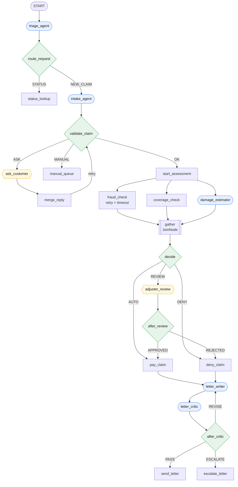

# adk-graph
This is a DevFest 2026 Demo Repository.

ClaimFlow An end-to-end insurance claims platform built as a single [Google ADK 2.0](https://google.github.io/adk-docs/) graph workflow. ClaimFlow takes a customer message (in English or Bahasa Indonesia), works out whether it is a new claim or a status question, collects and validates the claim details, runs fraud, coverage and damage checks in parallel, routes risky claims to a human adjuster, and finally writes and reviews a customer letter. It mixes LLM agents (where judgment or language is needed) with plain Python function nodes (where the rules are deterministic).

The business case follows an Indonesian insurer: amounts are in Rupiah, products and terms are local, and OJK (Otoritas Jasa Keuangan) is the regulator customers can escalate to.

> ⚠️ This is a demo. Policies, products, pricing and thresholds are simplified and are not real.

---

## Patterns demonstrated

| # | Pattern | Where it lives | ADK features used |
|---|---------|----------------|-------------------|
| 1 | **Router** | `triage_agent` → `route_request` | `output_schema`, routed `Event` |
| 2 | **Pipeline with a validation loop** | `intake_agent` → `validate_claim` ⇄ `ask_customer` → `merge_reply` | Back-edge, `RequestInput` (human-in-the-loop), state injection |
| 3 | **Fan-out and join** | `start_assessment` → (`fraud_check`, `coverage_check`, `damage_estimator`) → `gather` | Parallel branches, `JoinNode`, `RetryConfig`, node timeout |
| 4 | **Generator–critic loop** | `letter_writer` ⇄ `letter_critic` → `after_critic` | Back-edge, bounded rounds, instruction templating from state |
| 5 | **Human gate** | `decide` → `adjuster_review` → `after_review` | `RequestInput` with a typed `response_schema` |

---

## Workflow graph



**Legend:** blue rounded nodes are LLM agents, yellow hexagons pause the run for human input, green diamonds are routers, and plain rectangles are deterministic function nodes.

---

## Project structure

```
claimflow/
├── __init__.py   # Imports agent so `adk web` / `adk run` can find root_agent
├── agent.py      # The Workflow graph (root_agent): all edges and routes
├── agents.py     # LLM agents: triage, intake, damage estimator, letter writer, letter critic
├── nodes.py      # Function nodes: routing, validation, checks, decisions, human gates
├── schemas.py    # Pydantic models passed between nodes, plus the rupiah() formatter
└── data.py       # In-memory policies, claims and business thresholds
```

---

## Getting started

### Prerequisites

- Python 3.10 or newer
- A version of Google ADK that includes graph workflows (`google.adk.Workflow`, ADK 2.0)
- A Gemini API key from [Google AI Studio](https://aistudio.google.com/), or a Google Cloud project with the Gemini platform API (`aiplatform.googleapis.com`) enabled

### Install

```bash
git clone https://github.com/<your-username>/claimflow.git
cd claimflow/..          # the parent directory of the claimflow package
python -m venv .venv
source .venv/bin/activate      # Windows: .venv\Scripts\activate
pip install --upgrade google-adk
```

### Configure

Create a `.env` file inside the `claimflow/` package folder:

```dotenv
# Gemini via Google AI Studio
GOOGLE_GENAI_USE_ENTERPRISE=FALSE
GOOGLE_API_KEY=your-api-key

# Or Gemini on Google Cloud
# GOOGLE_GENAI_USE_ENTERPRISE=TRUE
# GOOGLE_CLOUD_PROJECT=your-project-id
# GOOGLE_CLOUD_LOCATION=global

# Demo switch: 1 (default) makes the first fraud-service call fail so you can
# watch the retry policy work. Set to 0 to turn the simulated failure off.
CLAIMFLOW_FLAKY=1
```

All agents use the model set in `agents.py` (`MODEL = "gemini-3.8-flash"`).

### Run

From the directory that **contains** the `claimflow/` folder:

```bash
adk web            # opens the dev UI; pick "claimflow" from the agent list
# or
adk run claimflow  # interactive terminal session
```

---

## Try it

### 1. Status question

```
Bagaimana status klaim CLM-0042?
```

Routed to `status_lookup`, which replies that the claim was paid and when the money was transferred.

### 2. Small car claim, approved automatically

```
Saya Budi Santoso, polis POL-1001. Mobil saya diserempet motor tanggal 2026-11-10,
biaya perbaikan sekitar Rp 8.500.000.
```

Covered peril, low fraud score and below the auto-approve limit, so the claim is paid without a human, and the letter goes through the writer–critic loop before it is sent.

### 3. Large flood claim, sent to an adjuster

```
Nama saya Siti Rahmawati, polis POL-2002. Rumah saya kebanjiran tanggal 2026-11-08,
kerugian sekitar Rp 120 juta.
```

The loss happened 3 days after the policy started and the amount is above Rp 100.000.000, so the fraud score reaches 0.7 and the run pauses at `adjuster_review`. Reply as the adjuster:

```json
{"approved": true, "approved_amount": 95000000, "note": "Survey confirmed flood damage"}
```

### 4. Claims that are denied

- **Lapsed policy:** a motorbike theft on `POL-3003` is denied because the policy is inactive (premium unpaid).
- **Peril not covered:** a flood on `POL-4004` is denied because the standard fire policy lacks the flood extension.

### 5. Missing details

```
Motor saya dicuri kemarin.
```

`validate_claim` finds missing fields and `ask_customer` pauses the run to ask for them. Reply in JSON, for example:

```json
{"policy_id": "POL-1001", "incident_date": "2026-11-12", "amount_claimed": 18000000}
```

The customer is asked at most twice; if details are still missing after that, the claim goes to `manual_queue` for a claims officer.

---

## Business rules

All thresholds live in `data.py` and `nodes.py`.

| Setting | Value | Effect |
|---------|-------|--------|
| `AUTO_APPROVE_LIMIT` | Rp 25.000.000 | Claims above this always go to an adjuster |
| `LARGE_CLAIM` | Rp 100.000.000 | Claims above this add +0.2 to the fraud score |
| `FRAUD_REVIEW_SCORE` | 0.6 | Fraud scores at or above this go to an adjuster |
| `MAX_INFO_REQUESTS` | 2 | Times the customer is asked for missing details |
| `MAX_LETTER_ROUNDS` | 3 | Writer–critic rounds before a letter is escalated to a human editor |
| `COMPLAINT_CONTACT` | OJK Contact 157 | Regulator contact the letter must mention |

**Fraud score.** Starts at 0.05, adds 0.45 if the loss occurred within 30 days of the policy start date, and adds 0.2 if the claimed amount is above `LARGE_CLAIM` (capped at 1.0).

**Payout.**

```
loss     = min(damage estimate, amount claimed, policy limit)
own risk = max(fixed own risk, own-risk percentage × loss)     # risiko sendiri
payable  = max(0, loss − own risk)
```

If an adjuster approves with an `approved_amount`, that amount is paid instead.

**Letter rubric.** The critic passes a letter only if it states the outcome in the first two sentences, gives the Rupiah amount or the denial reason, explains how to file an objection and mentions OJK Contact 157, and stays under 150 words without promising anything beyond the outcome.

### Sample policies

| Policy | Holder | Product | Covers | Status | Own risk |
|--------|--------|---------|--------|--------|----------|
| `POL-1001` | Budi Santoso | Comprehensive Car Insurance | Vehicle: collision, theft | Active | Rp 300.000 |
| `POL-2002` | Siti Rahmawati | Home Insurance + Flood Extension | Property: fire, flood | Active (from 2026-11-05) | max(Rp 1.000.000, 10%) |
| `POL-3003` | Agus Pratama | Motorbike TLO Insurance | Vehicle: theft | Inactive (premium unpaid) | — |
| `POL-4004` | Rina Wijaya | Standard Fire Insurance | Property: fire | Active | Rp 500.000 |

### Sample claims (for status lookups)

| Claim | Status |
|-------|--------|
| `CLM-0042` | Paid, Rp 4.750.000 transferred on 28 October 2026 |
| `CLM-0077` | Under surveyor review, decision within 2 working days |

---

## How the nodes talk to each other

- Each function node receives the previous node's output as `node_input`. Any other parameter (such as `attempts`, `claim` or `letter_rounds`) is filled from session state by name.
- A node returns `Event(output=..., route=..., state=..., message=...)`. `route` picks the outgoing edge, `state` updates session state, and `message` is shown to the user.
- Generator nodes (`yield`) can emit several events, for example a progress message followed by the real output.
- `RequestInput` pauses the whole run until a human replies; the reply is validated against `response_schema` and passed to the next node.
- `JoinNode` waits for every parallel branch and outputs a dict keyed by branch name, which `decide` reads as `node_input["fraud_check"]`, `node_input["coverage_check"]` and `node_input["damage_estimator"]`.

---

## Extending ClaimFlow

- **Add a policy or claim:** edit `POLICIES` or `CLAIMS` in `data.py`.
- **Change risk appetite:** adjust the thresholds in `data.py`.
- **Swap the fake fraud service for a real one:** replace the body of `fraud_check` in `nodes.py`; the retry and timeout policy already wraps it.
- **Use a different model:** change `MODEL` in `agents.py`.
- **Connect a real database:** replace the dictionaries in `data.py` with lookups against your policy and claims systems.
